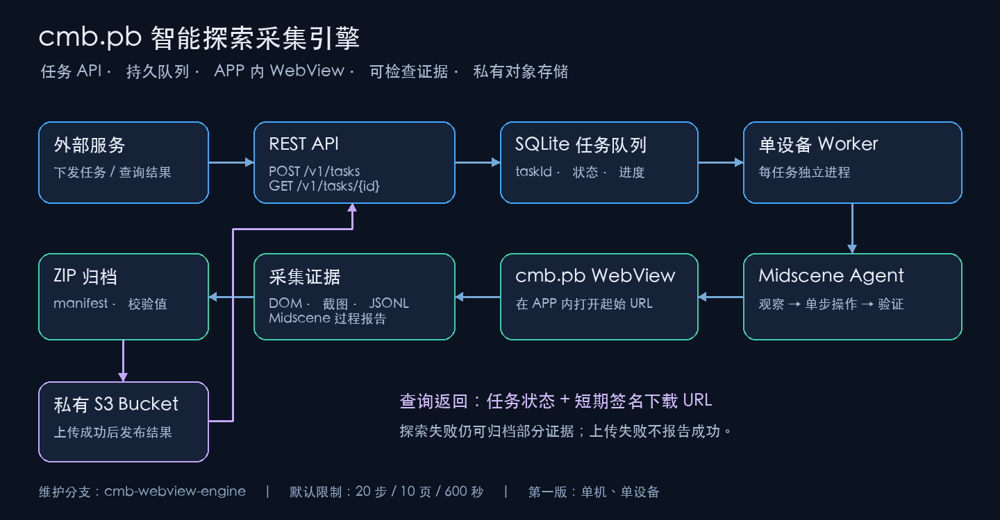

# cmb.pb WebView exploration service

[中文完整说明](./README.zh.md)

This branch adds an asynchronous REST service in `apps/webview-engine`. It uses the workspace `@midscene/web` SDK, a persistent SQLite queue, one device worker and an isolated process per task. Node.js 24+ is required; Node's built-in SQLite currently emits an experimental warning. Deploy on a persistent host that can reach the Android device.



## Run

```bash
pnpm install
pnpm exec nx build @midscene/webview-engine
pnpm exec nx build @midscene/report
cd apps/webview-engine
cp .env.example .env
# Configure API token, Android serial, model, allowed hosts and a private S3 bucket.
pnpm start
```

The upstream install prepares builds. When using `--ignore-scripts`, run the build targets above; the report target must replace the embedded template placeholder. The S3 bucket must already exist and be private. AWS SDK credentials use the standard provider chain. Put a TLS reverse proxy in front of externally exposed APIs.

The service pins Playwright 1.64.0. The upstream lockfile's 1.58.1 hung while connecting to this device's older WebView; 1.64.0 connected successfully. The driver uses CDP and ADB shell and omits native UI driver APK installation.

## Contract

Both endpoints require `Authorization: Bearer <ENGINE_API_TOKEN>`.

| Endpoint | Request | Response |
| --- | --- | --- |
| `POST /v1/tasks` | Required `startUrl`; optional `objective`, `expectedWebviewUrlPrefix`, `limits` | 202 with `taskId`, `status`, `statusUrl` |
| `GET /v1/tasks/{taskId}` | UUID path parameter | Status, progress, error, and uploaded result with a fresh presigned download URL |

```json
{
  "startUrl": "https://cmbls/functionjump?action=gocorpno&corpno=001003&cmb_app_trans_parms_start=here",
  "limits": { "maxSteps": 20, "maxPages": 10, "timeoutSeconds": 600 }
}
```

`corpno` is the mini app identifier. The native app route and resulting H5 URL can differ. A logged-in, remotely debuggable `cmb.pb` WebView must already be open. The driver assigns `window.location.href` inside that WebView and then requires a new or navigated matching target. Configure `CMB_LAUNCHER_URL_PREFIX` when multiple entry pages exist. Use `expectedWebviewUrlPrefix` when multiple destination pages might match. This opening strategy must be validated against the specific app version; a successful URL assignment alone does not prove the mini app opened. Foregrounding, login and device reconnection are environment prerequisites.

States are `queued → running → packaging → uploading → succeeded`; failures retain `failed`. Results remain null until an upload succeeds. Failed exploration can still have a downloadable partial bundle. GET URLs are freshly signed per query, defaulting to 900 seconds, configurable from 60 to 3600. Task limits default to 20 steps, 10 distinct URLs and 600 seconds, capped at 100, 50 and 3600. The task deadline kills the exploration process, including app opening and report finalization; packaging and upload follow, with a separate 120-second upload limit.

`Idempotency-Key` accepts 1–128 visible ASCII characters. The same key and normalized request returns the original task; a different request with that key returns 409. Invalid input returns 400, invalid authentication 401 and a missing task 404. This MVP uses a single service token and has no tenant isolation.

## Evidence and scope

Each ZIP contains `manifest.json`, `timeline.jsonl`, DOM/state/screenshot snapshots and the complete task-local Midscene report directory with its relative assets. Capture gaps are explicit. The model chooses one approved navigation control, a single scroll, Back or Finish. Unknown buttons require exact server-configured navigation labels. Payment, transfer, purchase, submission, deletion and authorization labels are blocked. Navigation filters and model localization do not guarantee arbitrary business links are side-effect-free; validate with a controlled test account and narrow scope. Exploration is bounded sampling, not exhaustive coverage.

Network evidence contains method, redacted URL, status and request identifiers, without authentication headers or payload bodies. Optional JSBridge wrapping records metadata only and may not cover native-injected functions. Initial traffic can predate debugger attachment, and native networking is outside this capture boundary. Request action IDs identify the action active at request start, not proven causality.

**DOM, screenshots and Midscene reports can contain personal information and are not content-anonymized.** Use a private bucket, short-lived signed URLs, deployment-specific encryption and retention policies. `.env`, local tasks and databases are ignored by Git. Local cleanup and bucket lifecycle policies are deployment responsibilities.

One coordinator is allowed per local data directory, and one task runs at a time. Never share a device between coordinators using different data directories. Queued tasks survive restart; interrupted running tasks fail without replaying app actions. Reports are replay evidence, not recoverable UI checkpoints. Keep SQLite on a local filesystem on one host.

## Local Docker storage

From this app directory, run `pnpm local-s3:up`, then `pnpm start:local-s3`. The Compose stack uses SeaweedFS 4.48 and exposes only the S3 port on `127.0.0.1:28333`. Random credentials and the test bucket configuration are written to ignored `.dev-s3/` and `.env.local-s3`; credentials are not printed. The bucket is `midscene-webview-test` and requires signed access. Run `pnpm local-s3:down` to stop the container while retaining its volume. Replace the S3 environment settings when migrating to another provider. See the [official SeaweedFS S3 documentation](https://github.com/seaweedfs/seaweedfs/wiki/Amazon-S3-API).

In another terminal, run `pnpm demo` to exercise both REST APIs with a 2-step, 3-page, 180-second movie page task. The client downloads the ZIP and verifies its SHA-256, saving under `data/downloads/` by default. Override `DEMO_API_URL`, `DEMO_START_URL` and `DEMO_OUTPUT_DIR` as needed.

The current acceptance URL is the caller-provided movie page at `https://movie-cui.paas.cmbchina.com/movie.html`, retaining its query parameters. Direct H5 URLs do not require `corpno`; the native app route remains a supported alternate format.

## Verify and maintain

```bash
pnpm exec nx test @midscene/webview-engine
pnpm exec nx build @midscene/webview-engine
pnpm run lint
```

Service tests use controlled drivers and an S3 HTTP protocol fixture. These do not validate the app entry, model behavior or a real object storage deployment.

Keep fork `main` aligned with upstream and maintain `cmb-webview-engine` as the business branch. Merge upstream through a temporary sync branch, then run the service tests, focused build, report build, lint and a fixed real-device acceptance flow. Future extensions include device pools, a shared task queue, cancellation, separate upload recovery and validated checkpoints.
