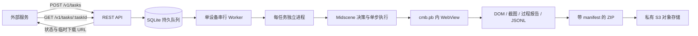

# cmb.pb WebView 智能探索采集服务

本分支在 `apps/webview-engine` 增加 REST API 和独立任务执行进程，复用本工作区的 `@midscene/web`，不改变上游 Agent 的核心行为。




## 安装和启动

运行环境：Node.js **24 或以上**、pnpm、ADB 可达的 Android 设备。Node 内置 SQLite 当前仍会显示实验性提示。服务部署在可持续连接设备的常驻主机上。

服务的 Playwright 固定为 1.64.0：本次设备验证中上游锁定的 1.58.1 连接旧 WebView 会挂起，1.64.0 可连接。服务通过 CDP 和 ADB shell 操作 WebView，不安装 Playwright 的原生 UI 驱动 APK。

从仓库根目录运行：

```bash
pnpm install
pnpm exec nx build @midscene/webview-engine
pnpm exec nx build @midscene/report
cd apps/webview-engine
cp .env.example .env
# 编辑 .env，配置设备、模型、允许域名、API Token 和 S3
pnpm start
```

上游 `pnpm install` 的 prepare 会构建依赖；如使用 `--ignore-scripts`，应运行上述构建目标。报告构建必须完成，否则上游报告模板可能仍是占位符。S3 bucket 应预先存在且保持私有，凭据只需要目标前缀的上传和下载权限。绑定公网时在服务前放置带 TLS 的反向代理。

测试和源码检查：

```bash
pnpm exec nx test @midscene/webview-engine
pnpm exec nx build @midscene/webview-engine
pnpm run lint
```

## APP 内打开 URL

设备上必须已有已登录、开启远程调试的 `cmb.pb` WebView。服务只枚举包名为 `cmb.pb` 的 WebView，通过该页面的 `window.location.href` 触发 APP 的 URL 拦截/路由。

本次测试入口为 `https://movie-cui.paas.cmbchina.com/movie.html`，保留调用方给定的查询参数。直接 H5 URL 不要求 `corpno`。以下 APP 内路由也作为另一种入口格式支持。

例如：

```text
https://cmbls/functionjump?action=gocorpno&corpno=001003&cmb_app_trans_parms_start=here
```

这里 `corpno` 是小程序应用号。`cmbls` 是 APP 路由入口；实际 H5 页面 URL 可以不同。入口触发后，服务等待新 WebView 或导航后文档，按 `CMB_WEBVIEW_HOSTS` 和可选 `expectedWebviewUrlPrefix` 匹配。没有出现可唯一确认的目标页面时任务失败，避免采集其他页面。

该方式依赖具体 APP 版本的导航拦截实现，不能仅凭入口 URL 赋值成功断言已打开小程序。若应用在后台，应先让它进入前台；若有多个起始 WebView，配置 `CMB_LAUNCHER_URL_PREFIX`。若 APP 需要测试工具或专用 JSBridge 打开入口，替换 `driver.mjs` 的 `connect` 中打开适配逻辑，再用真实设备验证。原生页面、登录、解锁和设备重连目前由运行环境准备。

## 两个 API

两个接口都需要 `Authorization: Bearer <ENGINE_API_TOKEN>`。

### 新增任务

`POST /v1/tasks` 返回 `202 Accepted`，任务入库后即可返回。

```json
{
  "startUrl": "https://cmbls/functionjump?action=gocorpno&corpno=001003&cmb_app_trans_parms_start=here",
  "objective": "探索小程序的可浏览页面，记录主要内容与导航关系",
  "expectedWebviewUrlPrefix": "https://your-miniapp.cmbchina.com/",
  "limits": { "maxSteps": 20, "maxPages": 10, "timeoutSeconds": 600 }
}
```

仅 `startUrl` 必填。`expectedWebviewUrlPrefix` 需替换为真实小程序地址；不知道地址时可省略，多个页面匹配则明确失败。`limits` 默认值如示例，上限依次为 100、50、3600。域名由服务端配置，调用者只能缩小页面匹配范围。未知字段会拒绝。

可提供 `Idempotency-Key`（1 至 128 个可见 ASCII 字符）避免重复下发：同 key、同规范化请求返回同 taskId；同 key、不同请求返回 409。当前为单个 API Token 的服务，不提供多租户隔离。

```json
{ "taskId": "<uuid>", "status": "queued", "statusUrl": "/v1/tasks/<uuid>" }
```

### 查询任务与下载结果

`GET /v1/tasks/{taskId}` 返回 `200 OK`。

```json
{
  "taskId": "<uuid>",
  "status": "succeeded",
  "corpno": "001003",
  "progress": { "runId": "<uuid>", "steps": 8, "pagesVisited": 4 },
  "result": {
    "key": "webview-tasks/<taskId>/<runId>.zip",
    "bytes": 123456,
    "sha256": "<sha256>",
    "format": "zip",
    "downloadUrl": "<fresh-presigned-get-url>",
    "expiresAt": "<ISO-8601>"
  },
  "error": null
}
```

状态：`queued → running → packaging → uploading → succeeded`，异常进入 `failed`。上传成功前 `result` 为 null。每次查询重新签发下载 URL，默认有效期 15 分钟，可在 60 至 3600 秒内配置。已成功上传部分证据的失败任务也有 `result`，但仍保持 `failed` 和错误字段。任务不存在返回 404；验证失败返回 400；无有效 Token 返回 401。

## 本地 Docker 对象存储

测试配置使用 SeaweedFS 4.48 的 S3 网关，只有 S3 端口映射到 `127.0.0.1:28333`。脚本生成随机凭据、创建测试 bucket，并写入 Git 忽略的 `.dev-s3/` 和 `.env.local-s3`，不会打印凭据。

```bash
cd apps/webview-engine
pnpm local-s3:up
# .env 中配置设备、模型、API Token；S3 配置由 .env.local-s3 覆盖。
pnpm start:local-s3
# 另一个终端通过两个 REST API 提交电影页面测试任务并校验下载包：
pnpm demo
# 停止测试容器，保留数据卷：
pnpm local-s3:down
```

bucket 为 `midscene-webview-test`，凭据需要签名访问。此 Compose 是本机测试环境，迁移到正式存储时替换 `.env` 中的 S3 配置。网关行为参考 [SeaweedFS S3 官方说明](https://github.com/seaweedfs/seaweedfs/wiki/Amazon-S3-API)。

`pnpm demo` 使用 2 步、3 页、180 秒的测试预算，下载 ZIP 后比对 SHA-256，默认保存到 `data/downloads/`。可通过 `DEMO_API_URL`、`DEMO_START_URL` 和 `DEMO_OUTPUT_DIR` 调整测试配置。

## 探索与证据

模型每轮读取可见界面和服务端批准的控件，选择一次点击、滚动、返回或结束。模型不能提供任意脚本。默认只批准允许域名的普通链接；导航按钮需用 `CMB_NAVIGATION_LABELS` 明确配置完整文字。禁止支付、转账、购票、提交、删除、签约等操作。策略过滤和模型定位只能降低误操作风险，不保证任意业务链接没有副作用；首次验证应使用隔离测试账号并收紧域名与导航范围。

同一状态/动作重复时停止。按不同 URL 统计页面，按页面内容和控件指纹统计状态；步数、页数或时间上限触发时停止。探索是预算内的采样，不保证所有路径覆盖。时间上限终止整个任务进程，避免 Promise 超时后后台继续点击。APP 启动、模型和报告收尾都在探索时间上限内，压缩和上传在之后完成（上传独立限时 120 秒）。

```text
collection.zip
├── README.md
├── manifest.json            # 版本、taskId/runId、统计、错误和采集边界
├── timeline.jsonl           # 决策、动作、网络/可选 bridge 元数据
├── snapshots/
│   ├── 0000.json            # URL、文字、控件、视口
│   ├── 0000.html            # DOM（最多 2 MiB）
│   └── 0000.png             # 截图（失败时在 JSONL 记录缺口）
└── midscene/
    └── report/              # Midscene HTML、dump 和相对路径资源
```

网络仅记录方法、脱敏 URL、状态与请求 ID；不保存认证头、请求/响应正文。Bridge 默认关闭，开启后仅记录可包装函数的调用元数据，不保存参数值，不代表完整双向调用或原生网络覆盖。请求按开始时的 actionId 归属；时间归属不是因果证明。不同进程/新 WebView 的初始流量可能早于监听安装。

**DOM、截图和 Midscene 报告不做内容级匿名化，可能包含个人信息。** 结构化事件的字段脱敏不等于整个压缩包匿名化。只使用私有 bucket 和短期签名下载地址，按需要设置对象存储加密与保留期限。本地 `.env`、数据库、产物不会提交到 Git；本地产物清理和 bucket 生命周期由部署方配置。

## 运行和长期维护边界

第一版是单机、单设备协调器；同一数据目录拒绝同时运行两个服务。不同数据目录不能共享同一个设备。SQLite/WAL 保留已排队任务，重启时继续处理；中断的运行任务标记失败，不自动重放 APP 操作。本地证据会保留，可人工归档；无可靠检查点的 UI 流程不会从报告恢复。不要把数据目录放到网络文件系统或复制到另一台运行主机。

fork 的 `main` 跟随上游，业务长期分支为 `cmb-webview-engine`。建议定期在单独分支合并上游，然后运行服务测试、报告构建和固定的真实设备验收流程：

```bash
git fetch upstream main
git switch cmb-webview-engine
git switch -c sync-midscene-YYYYMMDD
git merge upstream/main
pnpm install
pnpm exec nx test @midscene/webview-engine
pnpm exec nx build @midscene/webview-engine
pnpm exec nx build @midscene/report
pnpm run lint
```

下一阶段再扩展设备租约池、Postgres/任务队列、人工取消、上传独立重试和检查点恢复。新增能力前保持两个公开 API 的状态和产物契约可兼容。
